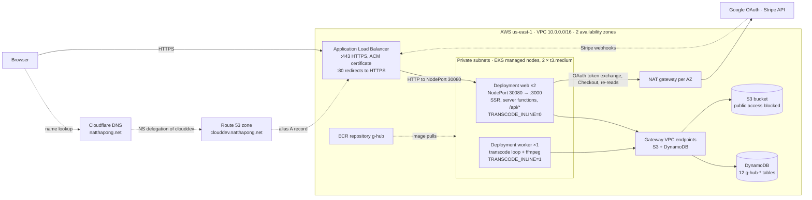
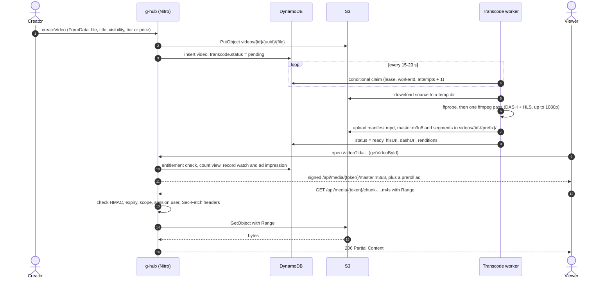
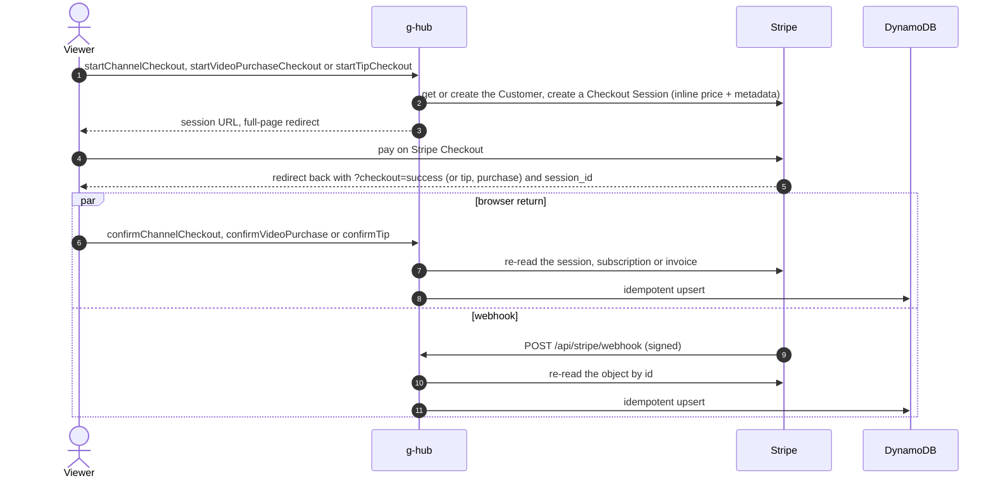
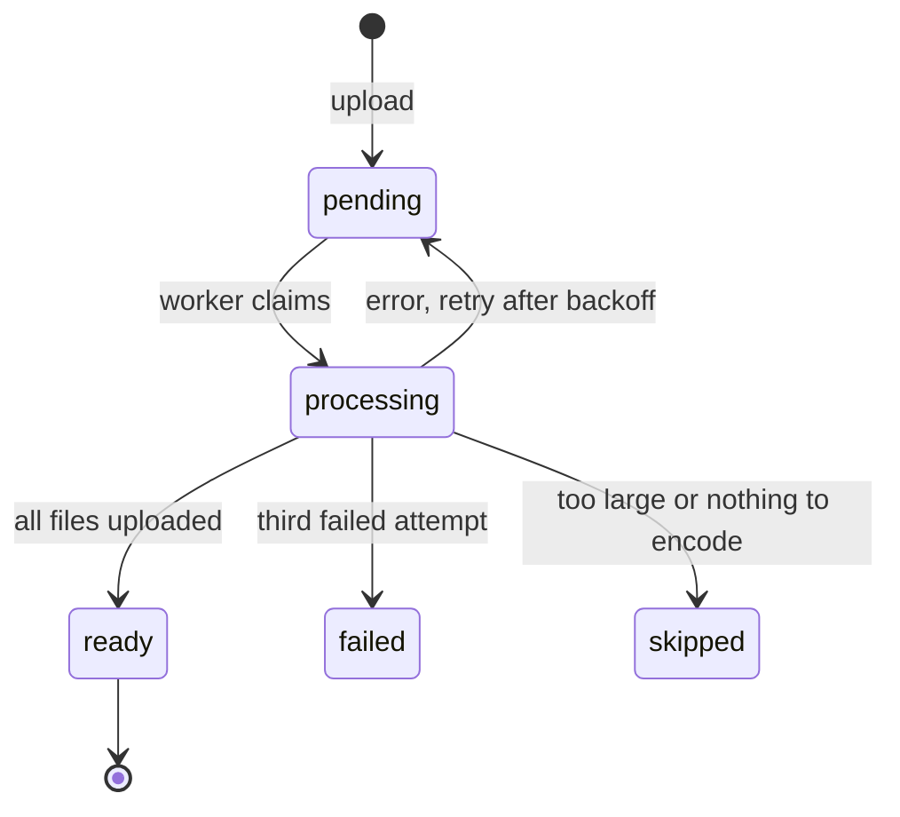
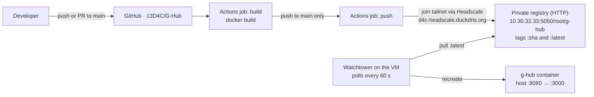

# G-Hub

Project for Cloud Application Development.

G-Hub is a video platform for creators. A creator uploads a video, the server transcodes it into
adaptive HLS and DASH streams, and viewers watch it in the browser. Creators earn money four ways:
monthly membership tiers, pay-per-view purchases, tips and preroll ads, all paid through Stripe
(test mode only). Every account is also a channel.

The whole system is one TypeScript codebase built on TanStack Start and Nitro. The same image runs
as a web server (pages, API, and every byte of media through a signed proxy) and as a transcode
worker (ffmpeg). Data lives in DynamoDB or MongoDB, chosen by one setting, and media in Amazon S3 or
any S3-compatible store. The look is a toilet-and-sewer "underwater" theme: a tiled background with
a WebGL water ripple, a toilet-paper-roll sidebar, and an upload button that says "Flush it in".

> **Production** runs on AWS: EKS behind an Application Load Balancer at
> **https://clouddev.natthapong.net**, with DynamoDB and S3. See
> [Deployment on AWS](#deployment-on-aws).

## Contents

- [What G-Hub does](#what-g-hub-does)
- [Tech stack](#tech-stack)
- [System topology](#system-topology)
- [Request flows](#request-flows)
- [Pages and API routes](#pages-and-api-routes)
- [Access model](#access-model)
- [Monetization](#monetization)
- [Personalized feed](#personalized-feed)
- [Media pipeline](#media-pipeline)
- [Data model](#data-model)
- [Authentication and sessions](#authentication-and-sessions)
- [Project structure](#project-structure)
- [Getting started](#getting-started)
- [Configuration](#configuration)
- [Scripts and tests](#scripts-and-tests)
- [Deployment on AWS](#deployment-on-aws)
- [Other deployment paths](#other-deployment-paths)
- [Known gaps and quirks](#known-gaps-and-quirks)

## What G-Hub does

**Viewers can:**

- Browse a personalized home feed. Videos are ranked by recency, popularity, channel subscriptions
  and watch history, and each card says why it was picked ("New from X", "Because you watched X",
  "Trending").
- See the latest uploads from the channels they pay for on `/subscribed`.
- Watch in an adaptive player with a manual quality picker (240p–1080p). Free videos open with a
  skippable preroll ad.
- Like, comment (and edit or delete their own comments), copy a share link, and tip a creator, either
  on a video or on the channel.
- Subscribe to a channel's membership tier or buy a single pay-per-view video, then manage or cancel
  in Stripe's billing portal.
- Sign in with email and password or with Google.

**Creators can:**

- Upload a video by drag-and-drop and decide who may watch it: everyone, subscribers (optionally from
  a minimum tier up), buyers at a set price, or nobody but themselves.
- Build a ladder of up to 10 membership tiers. A higher-ranked tier unlocks everything gated at a
  lower rank.
- Edit the channel's name and description.
- Use the **dashboard** to see views, likes, shares, subscribers, monthly recurring revenue, tips and
  sales; follow each video's transcode progress; change any video's access level and price inline;
  and edit or delete videos.
- Use the **revenue page** to see a monthly stacked chart of ad, subscription, pay-per-view and tip
  income for any year, plus all-time totals. It refreshes every 30 seconds.

**Not built yet:** search (the navbar search box has no handler) and creator payouts (see
[Monetization](#monetization)).

## Tech stack

| Layer | Technology |
|---|---|
| Framework | [TanStack Start](https://tanstack.com/start) (React 19, server-side rendering) on Nitro, built with Vite 8 |
| Routing and data | TanStack Router (file-based, [src/routes](src/routes)), TanStack Query 5 with the server's query cache hydrated into the browser, `createServerFn` server functions |
| UI | Tailwind CSS 4, shadcn-style Radix primitives ([src/components/ui](src/components/ui)), lucide icons, Recharts, jquery.ripples (WebGL water effect) |
| Video playback | video.js 8 with its built-in VHS engine (HLS and DASH) |
| Validation | zod |
| Database | Amazon DynamoDB (`@aws-sdk/lib-dynamodb`) or MongoDB (Mongoose 9), behind one repository layer ([src/server/data](src/server/data)) and selected by `DATA_BACKEND` |
| Object storage | Amazon S3 through `@aws-sdk/client-s3`; any S3-compatible store (SeaweedFS, MinIO) when `S3_ENDPOINT` is set |
| Transcoding | ffmpeg and ffprobe (libx264 + AAC) |
| Payments | Stripe Checkout, Billing Portal and webhooks, test mode only |
| Auth | Email and password (scrypt) or Google OAuth 2.0 with PKCE, stored in sealed cookie sessions |
| Tooling | TypeScript 6, oxlint; scripts run on Node's built-in TypeScript stripping |
| Delivery | Docker (`node:22-alpine`), Amazon EKS behind an ALB (Terraform), ECR, Route 53 (delegated from Cloudflare), ACM |

## System topology



The browser only ever talks to the app. It never touches S3: uploads go to a server function as
`FormData`, and playback goes through the signed `/api/media` proxy. Pods reach S3 and DynamoDB
through free gateway endpoints, and everything else (Google, Stripe, ECR) through the NAT gateways.

| Component | Role |
|---|---|
| `web` pods | Run the Nitro server on port 3000: SSR pages, server functions, `/api/media`, `/api/auth/google*`, `/api/stripe/webhook`. `TRANSCODE_INLINE=0` keeps ffmpeg off the CPU that answers requests and health checks. |
| `worker` pod | Same image with `TRANSCODE_INLINE=1`. Its Nitro plugin ([transcode.ts](src/server/plugins/transcode.ts)) claims videos from DynamoDB and encodes them. |
| ALB | Terminates HTTPS with an ACM certificate and forwards to NodePort 30080 on every node (an ASG attachment registers the nodes). Health check `GET /` every 30 s. |
| DynamoDB | All application data in 12 `g-hub-*` tables; also the transcode job queue (the `by-transcode` index). |
| S3 | One private bucket holding original uploads, transcoded segments and ad creatives. |
| Credentials | Pods use the nodes' `LabRole` through the instance metadata service (IMDSv2, hop limit 2). No AWS keys are configured in the app. |
| Cloudflare → Route 53 | Cloudflare hosts `natthapong.net` and delegates `clouddev` to a Route 53 zone with four NS records. In that zone, Terraform keeps an alias A record to the ALB and the ACM validation record. |
| Google, Stripe | Sign-in, and subscriptions / one-time payments / billing portal / webhooks. |

The app itself doesn't depend on this layout. Locally it runs as one process against MongoDB or
DynamoDB Local, and the older single-VM Docker deployment still works; see
[Other deployment paths](#other-deployment-paths).

## Request flows

### Upload, transcode and playback



The original upload is playable straight away. Until the transcode is `ready`, the player streams the
original MP4 and the page polls the transcode status every 5 seconds. Once the adaptive streams exist
it offers "Restart in adaptive quality", and the server stops issuing the MP4 URL.

### Payments (subscription, pay-per-view, tip)



Both paths record the same payment, and doing it twice is harmless: rows are upserted on the Stripe
session id or invoice id. Handlers take only an object id from the event or the browser and re-read
the object from Stripe, so amounts always come from Stripe, never from the client.

### Google sign-in

1. `GET /api/auth/google?redirect=/somewhere` creates a random `state` and a PKCE verifier, stores
   them in a 10-minute `oauth` cookie, and redirects to Google (`openid email profile`, S256 challenge,
   `prompt=select_account`).
2. `GET /api/auth/google/callback` deletes the `oauth` cookie (it is single-use), compares `state` in
   constant time, and exchanges the code and verifier for an `id_token`. It then checks `iss`, `aud`,
   `exp`, `sub`, `email` and `email_verified`.
3. The user is matched by `googleId`, or by email (which links an existing password account), or
   created new. The `auth` session cookie is set and the browser returns to `redirect`. That path is
   checked to be same-origin, so it can't be used as an open redirect.

## Pages and API routes

| Path | Search params | Sign-in | What it shows |
|---|---|---|---|
| `/` | — | no | Personalized feed of 30 videos (`listFeed`) |
| `/login` | `redirect`, `authError` | no; signed-in users are sent on | Login and register forms, and "Continue with Google" |
| `/subscribed` | — | yes | Recent videos from channels the viewer pays for (`listSubscribedVideos`) |
| `/video` | `id`, `tip`, `purchase`, `session_id` | no | Player, transcode notice, like / comment / share / tip, and "More videos". A locked video shows a paywall instead (subscribe, upgrade tier, or buy). |
| `/channel` | `id` (creator), `checkout`, `tip`, `session_id` | no | Channel profile, tier cards with subscribe buttons, manage subscription, tip, video grid. The owner also gets "Edit channel" and "Membership tiers". |
| `/dashboard` | — | yes | The signed-in user's own channel: stats, upload, and a per-video table for access level, price, edit and delete |
| `/revenue` | `year` | yes | Revenue by source and month, plus year and all-time totals |

| API route | Purpose |
|---|---|
| `GET /api/auth/google` | Start Google sign-in |
| `GET /api/auth/google/callback` | Finish Google sign-in and set the session |
| `POST /api/stripe/webhook` | Receive Stripe events, signature-checked |
| `GET`/`HEAD /api/media/:token/*` | Signed, session-bound media proxy with Range support |

The rest of the API is TanStack Start **server functions**, which the browser calls as RPC:

| File | Server functions |
|---|---|
| [auth.ts](src/server/functions/auth.ts) | `register`, `login`, `logout`, `me` |
| [videos.ts](src/server/functions/videos.ts) | `listVideos`, `listSubscribedVideos`, `getVideoById`, `getVideoTranscodeStatus`, `getPlaybackSources`, `getLockedVideo`, `createVideo`, `updateVideoDetails`, `deleteVideo` |
| [channels.ts](src/server/functions/channels.ts) | `getChannel`, `updateChannelSettings`, `startChannelCheckout`, `confirmChannelCheckout`, `openBillingPortal` |
| [membership-tiers.ts](src/server/functions/membership-tiers.ts) | `listMyMembershipTiers`, `createMembershipTier`, `updateMembershipTier`, `archiveMembershipTier`, `updateVideoAccess` |
| [video-purchases.ts](src/server/functions/video-purchases.ts) | `startVideoPurchaseCheckout`, `confirmVideoPurchase` |
| [tips.ts](src/server/functions/tips.ts) | `startTipCheckout`, `confirmTip` |
| [interactions.ts](src/server/functions/interactions.ts) | `getVideoInteractions`, `toggleVideoLike`, `listComments`, `createComment`, `updateComment`, `deleteComment`, `recordShare` |
| [feed.ts](src/server/functions/feed.ts) | `listFeed` |
| [dashboard.ts](src/server/functions/dashboard.ts) | `getCreatorDashboard` |
| [revenue.ts](src/server/functions/revenue.ts) | `getCreatorRevenue` |

Every input is validated with zod, and ids must be 24-character hex ObjectIds. The browser only ever
shows error messages on an allow-list (`src/lib/*-errors.ts`); any other server error is replaced
with a generic message.

Pages use two data patterns. Simple read-only pages use loader data. Interactive pages warm the
TanStack Query cache in the loader (`ensureQueryData`) and read it with `useQuery`, so a mutation can
invalidate one query instead of re-running the loader. Re-running the `/video` loader would rebuild
the player and replay the ad.

## Access model

Each video has one **visibility** ([video-visibility.ts](src/lib/video-visibility.ts)):

| Visibility | Who can watch | Preroll ads |
|---|---|---|
| `public` | Anyone, signed in or not | Yes, unless the viewer subscribes to the channel |
| `subscriber` | Active subscribers of the channel. If the video sets `requiredTierId`, only subscribers at that tier's rank or higher. | No |
| `buyer` | Anyone who bought this video. The purchase never expires. | No |
| `private` | The uploader only. Everyone else is told it doesn't exist. | No |

The rules:

- **A subscription counts** when Stripe reports it `active` or `trialing` and its `currentPeriodEnd`
  hasn't passed. Because of the date check, a lost renewal webhook fails closed.
  ([entitlement-status.ts](src/server/lib/entitlement-status.ts))
- **Tier check** ([tier-access.ts](src/server/lib/tier-access.ts)):
  - no required tier → allowed;
  - the viewer holds that exact tier → allowed;
  - otherwise allowed when `held.rank >= required.rank`.

  Rank decides, never price. Archived tiers keep their rank, so videos gated on them still work.
- **Subscriber and buyer are separate:** a subscription never opens a pay-per-view video.
- **The creator** always passes their own gates and never sees ads on their own channel.
- **Enforcement:** `requirePlayableVideo` ([entitlement.ts](src/server/lib/entitlement.ts)) runs in
  every playback and interaction server function. It throws `subscriptionRequired`, `tierRequired`,
  `purchaseRequired` or `videoNotFound`. The `/video` page turns the first three into a paywall,
  filled in by `getLockedVideo`, which returns a teaser (title, channel, tier, price) but never the
  media.
- **Catalogue pages** apply the same rules ([video-unlock.ts](src/server/lib/video-unlock.ts)) to show
  lock badges. Locked rows carry no media URL.

## Monetization

All money goes into **one Stripe account in test mode**: `getStripe()` refuses an `sk_live_` key
([stripe.ts](src/server/lib/stripe.ts)). There is no Stripe Connect, application fee or transfer.
Creator reports show 100% of the gross amount and nothing is paid out to creators. Each user gets one
Stripe Customer. Prices are created inline for each Checkout Session, so no Price objects are stored.

| Source | How it works | Limits | Stored in |
|---|---|---|---|
| Membership tiers | Monthly Stripe Checkout subscription. The subscription's metadata carries subscriber, creator and tier. Changes and cancellations go through the Billing Portal. There is no in-place upgrade: the viewer cancels first. | $0.50–$5,000 a month; up to 10 live tiers per creator; a price change applies only to new subscribers | `channelsubscription` (current state, copied from Stripe) and `subscriptioninvoice` (one row per paid invoice) |
| Pay-per-view | One-time Checkout payment. The price is read from the database, not the browser. | $0.50–$5,000 per video | `videopurchase`; the row itself grants access |
| Tips | One-time Checkout payment, on a video or as a channel donation. Grants no access. | $0.50–$5,000; presets $2, $5, $10 | `tip` |
| Preroll ads | A weighted random pick among active ads, skippable after a few seconds (default 3). Shown only on `public` videos to non-subscribers. | Signed-in repeat views count once per 30 minutes; anonymous views always count | `adimpression`; each one is valued at an **estimated** $2.50 CPM ([ad-revenue.ts](src/lib/ad-revenue.ts)) |

### Stripe webhook

[`POST /api/stripe/webhook`](src/routes/api/stripe/webhook.ts) checks the signature against
`STRIPE_WEBHOOK_SECRET` (a bad or missing signature gets 400) and returns 500 on errors so Stripe
retries.

| Event | Action |
|---|---|
| `checkout.session.completed`, `mode=payment` | `settlePaidSession`: records a tip or a video purchase |
| `checkout.session.completed`, `mode=subscription` | `syncSubscription` |
| `customer.subscription.created` / `updated` / `deleted` / `paused` / `resumed` | `syncSubscription`: re-reads the subscription and overwrites the local row |
| `invoice.paid` | `recordSubscriptionInvoice`: adds a row to the revenue ledger |
| anything else | 204, ignored. A failed payment still arrives, as `customer.subscription.updated`. |

### Revenue reporting

- `getCreatorRevenue` groups all four sources by UTC month and currency. Ad revenue is
  `impressions × $2.50 / 1000`. It is an estimate, and changing the constant re-prices all history.
- Only the channel's own currency (default `usd`) is counted. Other currencies are listed as
  excluded and never converted.
- Subscription and ad tracking began on **2026-09-21** ([revenue-tracking.ts](src/lib/revenue-tracking.ts)).
  For earlier months the chart shows "not recorded" rather than zero.
- The dashboard's monthly figure is different: it is a live sum of the prices of subscriptions that
  count right now, not of collected invoices.
- `npm run settle-payments` checks the last 30 days of Stripe sessions and invoices and records any
  the app missed, for example after a lost webhook. It can be run any number of times.

## Personalized feed

`listFeed` ([feed.ts](src/server/functions/feed.ts), [feed-ranking.ts](src/server/lib/feed-ranking.ts)):

1. **Candidates.** Up to 60 newest videos from channels the viewer pays for, plus up to 120 newest
   videos from the last 90 days. Duplicates are merged, and the subscription copy wins.
2. **Signals.** The viewer's 200 most recent watch records (`videoview`, kept 90 days) give
   "already watched" and per-creator watch counts. Anonymous viewers have no signals.
3. **Score**, with the weights from `DEFAULT_FEED_WEIGHTS`:

   ```text
   ageHours   = (now - createdAt) in hours
   recency    = 1 / (1 + ageHours / 72)                         // halves after 72 h
   popularity = min(1, log10(1 + views + 3*likes) / log10(1 + 10000))
   trending   = popularity * recency
   affinity   = min(1, watchesOfThisCreator / 5)
   score = 1.0*recency + 0.8*trending + 1.2*(subscribed ? 1 : 0)
         + 0.6*affinity - 0.7*(alreadyWatched ? 1 : 0)
   ```

4. **Order.** Sort by score, then newest. A creator's 4th and later videos move to the end of the
   list. Return the top 30.
5. **Reason label:** `subscription` if subscribed, else `affinity` if affinity > 0, else `trending`
   if trending ≥ 0.15, else `new`. `new` shows no label.

## Media pipeline

### Storage layout

```text
<S3_BUCKET>/
├── videos/{videoId}/{uploadUuid}/{original-file}   original upload
├── videos/{videoId}/{attemptPrefix}/               transcode output, a new prefix per attempt
│   ├── master.m3u8, <variant>.m3u8                 HLS playlists
│   ├── manifest.mpd                                DASH manifest
│   └── init-{rep}.m4s, chunk-{rep}-00001.m4s ...   fMP4 segments shared by HLS and DASH
├── videos/*.mp4, premium/*.mp4                     seed videos
└── ads/*.mp4                                       seed preroll ads
```

Rows store media as `s3://<bucket>/<key>` ([object-store.ts](src/server/storage/object-store.ts));
older rows with an `http(s)://` URL are still understood. Either form is turned back into a key when
a signed URL is made and never reaches the browser. Objects are written without a public ACL, and
on AWS the bucket's public access block (Terraform) refuses anonymous reads.
`npm run check:media-private` checks that.

### Transcoding

([transcode-plan.ts](src/server/lib/transcode-plan.ts), [transcode-queue.ts](src/server/lib/transcode-queue.ts),
[transcode-runner.ts](src/server/lib/transcode-runner.ts), [rendition-ladder.ts](src/lib/rendition-ladder.ts))

- **Output.** One ffmpeg pass using the DASH muxer with `-hls_playlist 1`, so the HLS and DASH
  manifests share the same segments.
  - 6-second segments, closed GOPs, constant frame rate.
  - Video: libx264 `veryfast`, High profile, yuv420p, 2 threads per encode.
  - Audio: one shared AAC track (128 kbps stereo, 48 kHz), if the source has audio.
- **Rendition ladder.** Measured on the short edge, so portrait video works, and never upscaled. A
  source smaller than 240p gets a single rung at its own size. Maxrate is 1.07× the target; buffer
  size is 2×.

  | Rung | 240p | 360p | 480p | 720p | 1080p |
  |---|---|---|---|---|---|
  | Video bitrate | 400 kbps | 800 kbps | 1400 kbps | 2800 kbps | 5000 kbps |

- **Queue.** The job lives on the video row itself. A worker claims a video whose status is
  `pending` or `processing`, whose next attempt is due, and which has had fewer than 3 attempts:
  - on MongoDB, with one atomic `findOneAndUpdate`;
  - on DynamoDB, by querying the `by-transcode` index for due videos and taking one with a
    conditional update that fails if another worker got there first.

  The claim sets a lease, a `workerId` and a fresh output prefix. A heartbeat renews the lease
  every fifth of its length; if the lease is lost, ffmpeg is aborted. Every final write checks
  `workerId`, so several workers can run at once.
- **Retries.** A failure retries after `TRANSCODE_RETRY_BASE_SECONDS × 5^(n−1)`, capped at 1 hour. The
  third failure is final.
- **Where it runs.**
  - By default, inside the web process ([plugins/transcode.ts](src/server/plugins/transcode.ts)). It
    polls every 15–20 seconds, runs `TRANSCODE_CONCURRENCY` encodes at a time, and switches itself
    off if ffmpeg is missing.
  - With `TRANSCODE_INLINE=0`, the web process skips it and `npm run transcode-worker` does the work.
  - `npm run transcode-one -- --video <id>` encodes one video in the foreground for debugging.
  - `npm run backfill:transcode` queues videos uploaded before this pipeline existed.



### Signed media URLs

Every video, segment, ad and catalogue preview the browser loads comes from
`/api/media/<token>/<file>` ([media-token.ts](src/server/lib/media-token.ts),
[media-url.ts](src/server/lib/media-url.ts), [api/media/$.ts](src/routes/api/media/$.ts)).

- **Token:** `v1.<base64url {s: scope, e: expiry, u: userId}>.<base64url HMAC-SHA256>`. The scope is
  either a directory, so one token covers a manifest and every segment next to it, or a single file
  (an MP4, ad or preview).
- **Key:** `MEDIA_SIGNING_SECRET`, or one derived from `SESSION_SECRET`.
- **Lifetime:**
  - `MEDIA_URL_TTL_SECONDS` (default 2 h), stretched to at least twice the video's length plus 10
    minutes.
  - Expiry is rounded up to 10-minute steps, so repeated requests get the same URL.
  - Previews last 30 minutes. Ad URLs are not tied to a viewer.
- **The proxy refuses a request** unless all of these hold. Every refusal is the same bare 403.
  - The `Sec-Fetch-*` headers say same-origin, not a page navigation, and a destination of
    `empty`, `video` or `audio`. Requests without these headers are allowed.
  - The HMAC is valid and the token hasn't expired.
  - The requested path is inside the token's scope. `..`, encoded slashes, backslashes and NUL are
    rejected.
  - The token's user is the session's user.
- **Responses:** Range requests pass through to S3 (206 or 416). Manifests are `no-store`. Segments
  are cached privately for whichever is shorter: the token's remaining life or 1 hour. Every
  response is `content-disposition: inline` with a same-origin resource policy.
- **Access is checked when a URL is issued, not on each segment.** Someone whose subscription ends
  can keep playing until their token expires. When a URL expires mid-watch, the player calls
  `getPlaybackSources` and carries on from the same position.

### Player anti-download measures

[video-player.tsx](src/components/video-player.tsx):

- The `<video>` element gets `controlsList="nodownload noremoteplayback"`,
  `disablePictureInPicture` and `disableRemotePlayback`, re-applied on every `loadstart`.
- The picture-in-picture button is removed.
- Right-click is blocked on the player and on card previews.
- Once HLS/DASH exist, the full MP4 is no longer handed out.

## Data model

Server functions never touch a database driver directly; they go through the repositories in
[src/server/data](src/server/data). `DATA_BACKEND=dynamo` selects the DynamoDB implementation
(production), anything else the MongoDB one. There is no channel table; a channel is a user.

DynamoDB tables (`<DYNAMODB_TABLE_PREFIX>-<name>`, defined in
[deploy/terraform/dynamodb.tf](deploy/terraform/dynamodb.tf)); the MongoDB collections hold the
same records under the same names without hyphens:

| Table | Holds | Key | Indexes |
|---|---|---|---|
| `users` | Accounts and channels | `id` | none. Unique email and Google id are enforced with guard items (`EMAIL#…`, `GOOGLE#…`) written in the same transaction |
| `videos` | Uploaded videos, with counters and the embedded transcode job | `id` | `by-creator` (uploadedBy, createdAt), `by-recency` (feedBucket, createdAt), `by-tier` (requiredTierId, id), `by-transcode` (transcodeStatus, transcodeNextAttemptAt) |
| `membership-tiers` | A creator's tier ladder; tiers are archived, never deleted | `id` | `by-creator` |
| `channel-subscriptions` | Local copy of each Stripe subscription | `subscriberId` + `creatorId` | `by-creator` |
| `subscription-invoices` | Ledger of paid subscription invoices | `stripeInvoiceId` | `by-creator` |
| `video-purchases` | Pay-per-view purchases | `stripeSessionId` | `by-creator`, `by-buyer` (buyerId, videoId) |
| `tips` | Paid tips and donations | `stripeSessionId` | `by-creator` |
| `video-likes` | One like per viewer per video | `videoId` + `userId` | none |
| `video-comments` | Comments (≤ 1000 characters) | `id` | `by-video` (videoId, id) |
| `video-views` | Watch history, used only for feed ranking | `viewerId` + `videoId` | local `by-last-watched`; rows expire after 90 days (TTL on `expiresAt`) |
| `ads` | Preroll creatives | `id` | `by-active` |
| `ad-impressions` | One row per ad shown | `id` | `by-creator` |

Keying the Stripe ledgers on the Stripe session or invoice id is what makes recording a payment
twice harmless. Stored `likeCount` can drift from the likes rows; `npm run recount-likes`
recomputes it.

## Authentication and sessions

([src/server/auth](src/server/auth))

- **Who can sign in:** only `@kmitl.ac.th` addresses, for both email/password and Google
  ([email-domain.ts](src/lib/email-domain.ts)).
- **Passwords:** Node `crypto.scrypt` with a random 16-byte salt, stored as `salt:hash` and compared
  in constant time. The minimum length is 8.
- **Sessions:** TanStack Start's `useSession` (h3) seals the session data into the cookie itself,
  encrypted and signed with `SESSION_SECRET`. There is no JWT and no session table.
  - `auth` cookie: `{userId}`, 7 days, `SameSite=Lax`, and `Secure` unless `APP_URL` is an
    `http://` address. Browsers drop `Secure` cookies on plain HTTP, so the site must be used over
    the scheme `APP_URL` names.
  - `oauth` cookie: OAuth state, PKCE verifier and redirect target, 10 minutes.
- **Guards:** `requireUserId()` reads the session for signed-in-only server functions. Protected
  pages redirect to `/login?redirect=<path>` in `beforeLoad`.

## Project structure

```text
.
├── src/
│   ├── routes/                 # file-based routes: pages + /api handlers
│   │   ├── __root.tsx          # HTML shell, water-ripple layer, navbar, sidebar
│   │   ├── index.tsx, video.tsx, channel.tsx, subscribed.tsx,
│   │   │   dashboard.tsx, revenue.tsx, login.tsx
│   │   └── api/                # auth/google, media/$, stripe/webhook
│   ├── components/             # player, upload form, tier editor, tip/buy buttons, chart…
│   │   └── ui/                 # shadcn-style Radix primitives
│   ├── lib/                    # shared client/server helpers: query options, visibility,
│   │                           #   rendition ladder, prices, email domain, error allow-lists
│   ├── server/
│   │   ├── auth/               # sessions, scrypt, Google OAuth, requireUserId
│   │   ├── data/               # repositories: index.ts picks dynamo/ or mongo/ by DATA_BACKEND
│   │   ├── db/                 # Mongoose connection + models (MongoDB backend only)
│   │   ├── functions/          # createServerFn endpoints (the app's API)
│   │   ├── lib/                # entitlement, feed ranking, Stripe, ads, revenue,
│   │   │                       #   media tokens, transcode queue/runner/worker
│   │   ├── plugins/            # Nitro boot plugins: db, transcode
│   │   └── storage/object-store.ts  # S3 client (AWS S3 or an S3-compatible endpoint)
│   ├── router.tsx              # router + per-request QueryClient
│   └── index.css               # Tailwind theme, textures, underwater effects
├── scripts/                    # seed, migrations, ops tools, transcode worker, test-*.ts
├── public/                     # favicon, avatar fallback, background textures
├── deploy/
│   ├── terraform/              # AWS: VPC, EKS, ALB + ACM, DynamoDB, ECR (the live stack)
│   ├── k8s/                    # manifests + secret.sh and deploy.sh for that stack
│   └── docker-compose.yml      # older single-VM deployment: app + Watchtower
├── terraform/, opentofu/       # alternative AWS stack: EKS with a Classic LB, deploy.sh
├── .github/workflows/ci-cd.yml # build image; push to the VM's private registry on main
├── Dockerfile                  # node:22-alpine, two stages, includes ffmpeg
└── .env.example                # every setting, with comments
```

`src/routeTree.gen.ts` is generated by the router plugin on `dev` or `build` and is not committed.

## Getting started

**You need:**

- Node.js 22
- A data store: Docker for DynamoDB Local, or a MongoDB instance
- An S3 bucket: real Amazon S3 (credentials in `~/.aws`), or SeaweedFS/MinIO with an access key
- *Optional:* ffmpeg and ffprobe on `PATH`. Without them, videos play from the original upload.
- *Optional:* the Stripe CLI, for payments in local development
- *Optional:* a Google OAuth client. Without one, use email and password sign-in.

```bash
npm ci
cp .env.example .env   # set SESSION_SECRET (32+ chars), S3_* and one data backend:
                       #   DynamoDB Local: DATA_BACKEND=dynamo, DYNAMODB_ENDPOINT=http://127.0.0.1:8000,
                       #                   DYNAMODB_ACCESS_KEY_ID=local, DYNAMODB_SECRET_ACCESS_KEY=local
                       #   MongoDB:        DATA_BACKEND=mongo, MONGODB_URI=mongodb://...

# DynamoDB Local only: start it and create the 12 tables
docker run -d -p 8000:8000 amazon/dynamodb-local
npm run dynamo:create-tables

npm run dev            # http://localhost:3000

# For payments, in a second terminal. Copy the whsec_... it prints into STRIPE_WEBHOOK_SECRET.
stripe listen --forward-to localhost:3000/api/stripe/webhook
```

- **Accounts:** sign-up only accepts `@kmitl.ac.th` addresses.
- **Cookies:** with `APP_URL` unset, session cookies are `Secure`. Most browsers accept that on
  `http://localhost`; if yours doesn't, set `APP_URL=http://localhost:3000`.
- **Google sign-in:** register `http://localhost:3000/api/auth/google/callback` as an authorized
  redirect URI.
- **Demo content:** put MP4 files in `seed/videos/` (public), `seed/premium/` (subscribers only) and
  `seed/ads/` (preroll ads), then run `npm run seed`. It creates a demo creator from the `SEED_*`
  settings with one "Membership" tier.
- **Production build:** `npm run build && npm start`.

## Configuration

Settings are read from the environment at runtime. [.env.example](.env.example) lists all of them
with comments. On AWS they come from the ConfigMap in [deploy/k8s/config.yaml](deploy/k8s/config.yaml)
and the Secret written by [deploy/k8s/secret.sh](deploy/k8s/secret.sh).

| Variable | Required | Default / notes |
|---|---|---|
| `SESSION_SECRET` | yes | 32+ characters; seals session cookies and, by default, media tokens |
| `APP_URL` | in production | Public origin, e.g. `https://clouddev.natthapong.net`. Used for Stripe return URLs, and an `http://` value turns off `Secure` cookies |
| `DATA_BACKEND` | no | `mongo` (default) or `dynamo` |
| `MONGODB_URI` | with `mongo` | — |
| `DYNAMODB_TABLE_PREFIX` | no | `g-hub`; tables are `<prefix>-<name>` |
| `DYNAMODB_ENDPOINT`, `DYNAMODB_ACCESS_KEY_ID`, `DYNAMODB_SECRET_ACCESS_KEY` | DynamoDB Local only | Leave unset on AWS, where the node's role supplies credentials |
| `AWS_REGION` | no | `us-east-1`, for both DynamoDB and S3 |
| `S3_BUCKET` | yes | `g-hub-media` |
| `S3_ENDPOINT`, `S3_ACCESS_KEY_ID`, `S3_SECRET_ACCESS_KEY` | S3-compatible stores only | Leave unset for Amazon S3. The older `SEAWEED_S3_*` names still work, so make sure none are set on AWS |
| `S3_CORS_ORIGINS` | no | `*`; used only by `npm run set-bucket-cors` |
| `GOOGLE_CLIENT_ID`, `GOOGLE_CLIENT_SECRET` | for Google sign-in | — |
| `GOOGLE_REDIRECT_URI` | behind a proxy or ALB | Defaults to `<request origin>/api/auth/google/callback`; behind the ALB the request is plain HTTP, so set it to the https URL |
| `STRIPE_SECRET_KEY` | for payments | Must be `sk_test_...` |
| `STRIPE_WEBHOOK_SECRET` | for payments | `whsec_...` of the endpoint that calls this deployment |
| `MEDIA_SIGNING_SECRET` | no | 32+ characters; set it to rotate media URLs without logging everyone out |
| `MEDIA_URL_TTL_SECONDS` | no | `7200` (minimum 60) |
| `FFMPEG_PATH` / `FFPROBE_PATH` | no | `ffmpeg` / `ffprobe` from `PATH` |
| `TRANSCODE_INLINE` | no | `1`; `0` keeps encoding out of the process (the `web` pods) |
| `TRANSCODE_CONCURRENCY` | no | `1` encode per process (each uses 2 threads) |
| `TRANSCODE_LEASE_SECONDS` | no | `300` (minimum 30) |
| `TRANSCODE_RETRY_BASE_SECONDS` | no | `60`, multiplied by 5 after each failure |
| `TRANSCODE_MAX_SOURCE_MB` | no | `2048`; larger sources are `skipped` |
| `TRANSCODE_TMP_DIR` | no | The OS temp directory |
| `SEED_CREATOR_EMAIL`, `SEED_CREATOR_NAME`, `SEED_CHANNEL_PRICE_CENTS`, `SEED_TIER_NAME` | seed only | `SEED_CHANNEL_PRICE_CENTS` defaults to `499`, `SEED_TIER_NAME` to `Membership` |
| `MIGRATE_TIER_NAME` | migration only | `Membership` |

## Scripts and tests

| Command | What it does |
|---|---|
| `npm run dev` / `build` / `start` / `preview` | Dev server on :3000 / production build into `.output/` / run the build / Vite preview |
| `npm run lint` / `typecheck` | oxlint / `tsc --noEmit` (run `dev` or `build` once first, to generate the route tree) |
| `npm run dynamo:create-tables` | Create the 12 tables on DynamoDB Local (AWS tables come from Terraform) |
| `npm run seed` | Upload `seed/**/*.mp4` and create the demo creator, tier, videos and ads |
| `npm run transcode-worker` (`:once`) | Standalone transcode worker loop (or a single pass) |
| `npm run transcode-one -- --video <id>` | Encode one video in the foreground |
| `npm run backfill:transcode` (`:apply`) | Queue older videos for transcoding; a dry run unless you use `:apply` |
| `npm run settle-payments` | Record any Stripe payments from the last 30 days the app missed |
| `npm run recount-likes` | Recompute each video's `likeCount` from the likes |
| `npm run check:media-private` | Fail if anonymous reads of the bucket still succeed |
| `npm run set-bucket-cors` | Apply the bucket CORS policy (no longer needed for playback) |
| `npm run migrate:channel-price` / `migrate:visibility` | One-off data migrations; dry run unless you pass `--apply` |

**Tests** are plain scripts in [scripts/](scripts) using `node:assert/strict`, with no test
framework. Run one with `npm run test:<name>`, for example `npm run test:feed-ranking`. There is no
single `npm test`.

- `repo-contract` runs the same assertions against whichever backend `.env` selects; it is the check
  that the DynamoDB and MongoDB repositories behave alike.
- These need a MongoDB from `.env`: `channel-gate`, `ppv-gate`, `membership-tier`,
  `revenue-ledger`, `watch-history`, `transcode-claim`.
- The rest are pure unit tests: `entitlement`, `tier-access`, `payment-kind`, `video-price`, `tips`,
  `dashboard`, `video-unlock`, `feed-ranking`, `revenue-series`, `transcode-status`,
  `transcode-plan`, `video-sources`, `video-quality`, `media-token`, `object-store`,
  `email-domain`.

## Deployment on AWS

The live stack is [deploy/terraform](deploy/terraform) plus [deploy/k8s](deploy/k8s), in an AWS
Academy Learner Lab account (region `us-east-1`; every role is `LabRole`). The diagram is under
[System topology](#system-topology).

| File | Creates |
|---|---|
| [vpc.tf](deploy/terraform/vpc.tf) | VPC `10.0.0.0/16`; 2 public and 2 private subnets across 2 AZs; internet gateway; a NAT gateway per AZ; gateway endpoints for S3 and DynamoDB |
| [eks.tf](deploy/terraform/eks.tf) | EKS cluster, with `api` and `audit` control plane logs sent to the CloudWatch log group `/aws/eks/g-hub/cluster` (kept 7 days); a managed node group of 2 × t3.medium (AL2023) in the private subnets, with a launch template that sets the IMDSv2 hop limit to 2 so pods can use the node's `LabRole` |
| [alb.tf](deploy/terraform/alb.tf) | Application Load Balancer; ACM certificate for `clouddev.natthapong.net`; HTTPS :443 listener; HTTP :80 redirect; target group on NodePort 30080, fed by the node group's ASG |
| [route53.tf](deploy/terraform/route53.tf) | In the existing `clouddev.natthapong.net` zone: an alias A record to the ALB and the certificate's validation record |
| [deploy/dns](deploy/dns/main.tf) | A separate, long-lived stack holding only the Route 53 zone, so its nameservers (which Cloudflare points at) survive `terraform destroy` of the app |
| [dynamodb.tf](deploy/terraform/dynamodb.tf) | The 12 `g-hub-*` tables |
| [data.tf](deploy/terraform/data.tf) | ECR repository; public access block and owner-enforced objects on the existing media bucket |
| [deploy/k8s](deploy/k8s) | Namespace `g-hub`; ConfigMap `app-config`; `web` Deployment (×2) + NodePort Service; `worker` Deployment (×1); `secret.sh` writes Secret `app-secrets` from `.env`; `deploy.sh` builds, pushes and rolls out |

**First deploy**

1. Put the Learner Lab's credentials ("AWS Details → AWS CLI") in `~/.aws/credentials`.
2. **Once only:** `cd deploy/dns && terraform init && terraform apply`, then
   `terraform output cloudflare_ns_records`. In Cloudflare, remove any other record named
   `clouddev` (or under it), and add the four NS records it prints, each named `clouddev`.
   `dig +short NS clouddev.natthapong.net` should then list the `awsdns` servers.
3. `cd deploy/terraform && terraform init && terraform apply`. It writes the ALB record and the
   certificate validation record into the zone, and finishes once ACM issues the certificate.
4. `deploy/k8s/deploy.sh`. It builds a `linux/amd64` image, pushes it to ECR, writes the Secret,
   applies the manifests and restarts both Deployments.
5. Register `https://clouddev.natthapong.net/api/auth/google/callback` with the Google OAuth client.
   Add a Stripe test webhook endpoint `https://clouddev.natthapong.net/api/stripe/webhook`
   (`checkout.session.completed`, `invoice.paid`, `customer.subscription.*`), put its `whsec_` in
   `.env`, and run `deploy/k8s/secret.sh` and a restart (or `SKIP_BUILD=1 deploy/k8s/deploy.sh`).

**Every lab session**

- The credentials change each session: paste them into `~/.aws/credentials` again.
- When a session ends the lab stops the nodes, and the site returns 502 until they are back. If
  `kubectl get nodes` stays empty after the lab restarts, terminate the two node instances; the node
  group replaces them and they register fresh.
- Code changes: `deploy/k8s/deploy.sh`. Config or secret changes only: `SKIP_BUILD=1 deploy/k8s/deploy.sh`.
- To stop spending credit, `terraform destroy` in `deploy/terraform` (about $6 a day while it
  exists). Leave `deploy/dns` alone; its zone costs $0.50 a month and keeps Cloudflare's NS records
  valid for the next apply. Destroy it only when retiring the domain, and remove the NS records then.

## Other deployment paths

**Teammate's AWS stack** ([terraform/](terraform), with an OpenTofu port in [opentofu/](opentofu)):
the same app on EKS, but exposed through a Classic Load Balancer created by a Kubernetes
`LoadBalancer` Service, and driven entirely by `terraform/deploy.sh` / `destroy.sh`. See
[terraform/README.md](terraform/README.md). It creates its own VPC, cluster, tables and bucket, so
don't run it in the same account as `deploy/terraform` without changing names.

**Single VM with Docker** (the original deployment):



- **Image** ([Dockerfile](Dockerfile)): two stages on `node:22-alpine`. The runtime stage installs
  `ffmpeg`, copies only `.output/`, and health-checks `/` every 30 s (10 s timeout, loose enough to
  survive a busy transcode).
- **CI/CD** ([ci-cd.yml](.github/workflows/ci-cd.yml)): every PR and push to `main` builds the image;
  a push to `main` also joins the Tailscale network and pushes `:<sha>` and `:latest` to the VM's
  registry. Watchtower on the VM recreates the container. CI does not deploy to AWS.
- **Runtime** ([deploy/docker-compose.yml](deploy/docker-compose.yml)): `app` on host port 8080 and
  `watchtower`. Only `MONGODB_URI` is passed through, so that deployment uses MongoDB and needs the
  rest of its settings supplied on the VM.

## Known gaps and quirks

| Area | What to know |
|---|---|
| Sign-up | Only `@kmitl.ac.th` addresses can register or sign in. |
| CI | CI only builds the image and pushes it to the VM registry. It runs no lint, type check or tests, and AWS deploys are manual (`deploy/k8s/deploy.sh`). |
| Uploads | `createVideo` reads the whole file into memory before writing it to S3, and there is no upload size limit. A large upload can exceed the `web` pod's 1 GiB memory limit. |
| Feed index | Every video shares one `feedBucket` value in the `by-recency` index, so the home feed reads a single DynamoDB partition. Fine at this scale. |
| Learner Lab | Credentials expire with each session, and nodes stop between sessions (see [Every lab session](#deployment-on-aws)). |
| View counts | A view is counted on every load of `/video`, including reloads. Repeat ad impressions are de-duplicated for signed-in viewers only. |
| Revoked access | Media access is checked when a URL is issued. Someone who loses access can keep playing until the token expires (at least 2 hours). |
| Sessions | Sessions aren't checked against the database, so a session can outlive a deleted account (up to 7 days). |
| Payouts | No revenue split and no creator payouts. All money stays in the platform's test-mode Stripe account. |
| Search | The navbar search box isn't wired up yet. |
| Standalone worker | `scripts/` isn't in the Docker image. Containers transcode with the in-process plugin, which is what the `worker` Deployment runs. |
| UI copy | The tier editor says a channel with no tiers sells "one flat subscription", but the channel page offers nothing to subscribe to in that case. |
| Theme | A `.dark` theme is defined but never applied. |
